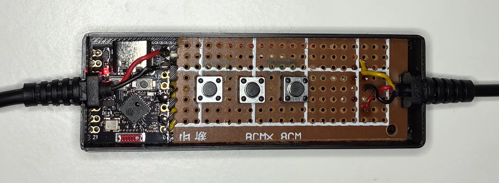
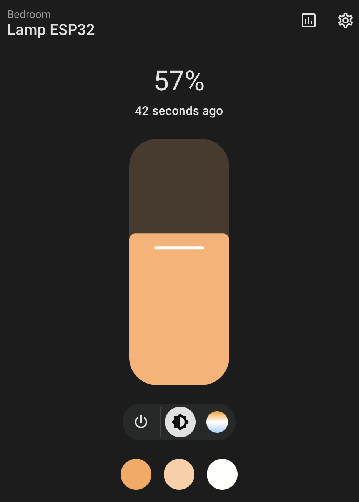

# ESP32 smart desk lamp

A two-channel LED desk lamp converted into a smart Wi-Fi lamp using an ESP32 and ESPHome, with Home Assistant integration.

The original lamp controller was replaced with an ESP32 and a custom circuit. A custom enclosure was designed and 3D printed ([preview the 3D model](./3d/lamp.stl)).



## Features

- 3 color modes: warm, cool, and mixed
- Adjustable brightness
- Home Assistant integration (color, brightness control)
- Physical buttons
- Wi-Fi

## Hardware

- ESP32-C3 Super Mini
- 2 x AO3400A N-channel MOSFET
- 3 buttons

### Pins

| GPIO  | Component       |
| ----- | --------------- |
| GPIO4 | MOSFET warm LED |
| GPIO5 | MOSFET cool LED |
| GPIO0 | BUTTON main     |
| GPIO1 | BUTTON -        |
| GPIO3 | BUTTON +        |

## Setup

**Requirement**: [ESPHome](https://esphome.io/)

```sh
# Copy and fill wifi credentials
cp secrets.example.yaml secrets.yaml

# Validate configuration
esphome config lamp.yaml

# Compile firmware
esphome compile lamp.yaml

# Upload firmware
esphome run lamp.yaml [--device <ip>]
```

## Usage

### Home Assistant

Go to *Settings* > *Devices & services* > *Add integration* > "*ESPHome*".



### Physical buttons

| Button             | Action              |
| ------------------ | ------------------- |
| Main (long press)  | Turn on/off         |
| Main (short press) | Cycle color modes   |
| +                  | Increase brightness |
| -                  | Decrease brightness |
